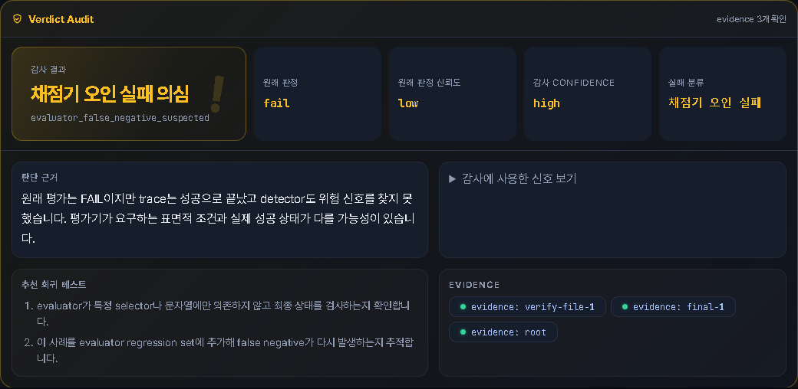
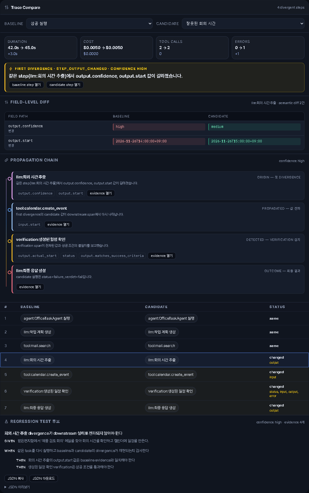
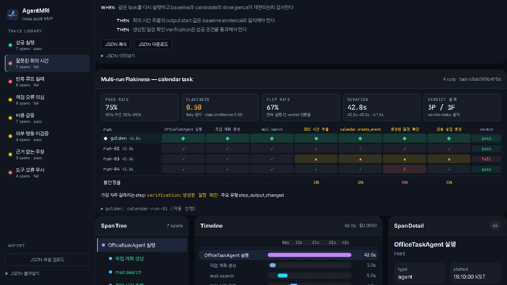

<p align="center">
  
</p>

# AgentMRI

AI 에이전트의 실행 로그와 평가 결과를 입력받아 실패 원인, 채점 오류, 회귀 테스트 후보를 evidence 기반으로 도출하는 메타-평가 도구다.

AgentMRI는 Langfuse 같은 observability 플랫폼을 대체하지 않는다. 그 위에서 **이 실행을 믿어도 되는지, 원래 PASS/FAIL 판정이 맞는지**를 감사하는 상위 계층을 목표로 한다.

## 화면

### Verdict Audit — 원래 평가가 맞는지 재감사

원래 PASS 판정이어도 trace evidence가 실패 위험을 가리키면 `evaluator_false_positive_suspected`로 재분류한다.



### Trace Compare — divergence 진단부터 regression test export까지

두 실행을 step 단위로 정렬해 처음 갈라지는 지점을 찾고, field-level diff와 propagation chain으로 원인이 downstream에 퍼지는 경로를 추적한 뒤 regression test 후보 JSON으로 export한다.



### Multi-run Flakiness — 같은 task N회 실행의 불안정 지도

task fingerprint로 묶인 실행 그룹에서 golden을 자동 선정하고, run × step 매트릭스로 어느 step이 얼마나 자주 갈라지는지 보여준다. pass rate는 Wilson 신뢰구간과 함께 표시된다.



### Trace Explorer — span tree, timeline, findings

실행 구조를 span tree와 timeline으로 탐색하고, detector finding이 인용하는 evidence span을 확인한다.


## 현재 상태

### 감사·진단 코어

- canonical trace TypeScript schema + validation (evidence validator가 존재하지 않는 span 인용을 거부)
- 규칙 기반 detector 6종 — D01 반복 도구 루프, D03 도구 오류 무시, D04 최종 검증 누락, D05 검증 없는 외부 행동, D06 비용 급증, D09 근거 없는 주장
- verdict audit — true pass/fail 판정, evaluator false positive/negative 의심 재분류, 신뢰도·confidence 표시
- 샘플 trace 8종 + multi-run fixture 4종

### Trace Compare — 비교·진단·regression 생성 루프

- baseline/candidate step alignment + first divergence 자동 탐지 + divergence type 11종 분류
- field-level diff (noise 규칙으로 식별자·timestamp·usage 제외, semantic diff만 표시)
- propagation chain — divergence가 downstream으로 퍼지는 evidence 경로 추적
- regression test 후보 자동 생성 — given/when/then + assertion DSL, JSON 복사/다운로드
- **regression candidate → 실행 가능한 pytest 컴파일** — standalone 파일 다운로드, golden에서는 통과하고 regression에서는 실패 (표준 라이브러리만 사용)
- **외부 포맷 자동 변환** — OTLP(resourceSpans), LangSmith run export(run_type/child_runs), Langfuse(observations) JSON을 붙여넣거나 업로드하면 canonical trace로 자동 변환. gen_ai 시맨틱 컨벤션, usage/cost, 에러 상태, 계층 구조 매핑
- **CI audit gate** — `npx tsx scripts/agentmri-audit.ts`로 high/critical finding, verdict 재분류, verification 소실 시 exit 1. GitHub Actions 요약 출력 지원
- compare-aware audit — 비교 evidence를 verdict 판정 신뢰도 계산에 융합 (verification 소실 시 false positive 재분류, golden과 동일한데 FAIL이면 false negative 근거 강화)

### Multi-run Flakiness (같은 task N회 실행 분석)

- task fingerprint — 정규화된 TaskSpec 해시로 같은 task 실행을 자동 grouping
- golden 자동 선정 — medoid 휴리스틱 + 근거 기록, 수동 override 지원
- flakiness 지표 — pass rate + Wilson 신뢰구간, instability score, flip rate, data confidence
- step별 divergence/presence rate — 가장 자주 갈라지는 step 자동 식별

### 시각화

- hierarchical waterfall (time ruler, 계층 indent, verification/error 마커, evidence 점) + cost burnup lane
- alignment subway map — 두 실행의 구조적 정렬을 연결선 그래프로
- divergence river — 실패 전파 경로를 시간축 위에
- flaky step matrix — run × step 불안정 지도
- semantic diff tree — 문자 단위 인라인 하이라이트 diff
- regression coverage overlay — assertion이 보호하는 step 표시
- step duration / metric paired 비교 차트

아직 구현하지 않은 것:

- LLM Compare Analyst (deterministic 분석 결과의 자연어 설명 — evidence 인용 검증 포함)
- Langfuse/OpenTelemetry adapter
- 실제 mock office browser benchmark

## 실행

### 프론트엔드

```bash
npm install
npm run dev
```

브라우저에서 `http://localhost:3000`을 연다.

### 프론트엔드 테스트와 빌드

```bash
npm test
npm run typecheck
npm run build
```

### 백엔드

```bash
pip install -r api/requirements.txt
uvicorn api.app.main:app --reload
```

API 확인:

```bash
curl http://localhost:8000/health
```

### CI audit gate

```bash
# 단일 trace 감사
npx tsx scripts/agentmri-audit.ts --candidate run.json

# golden과 비교 감사 — verification 소실까지 탐지
npx tsx scripts/agentmri-audit.ts --baseline golden.json --candidate run.json
```

high/critical detector finding, `evaluator_false_positive/negative_suspected` 재분류, verification 소실이 있으면 exit code 1로 CI를 차단한다. audit가 확인한 `true_failure`도 차단 대상이다.

multi-run flakiness 모드 — 같은 task의 실행 여러 개를 디렉터리로 넘기면 task fingerprint로 묶어 불안정성을 판정한다:

```bash
npx tsx scripts/agentmri-audit.ts --runs traces/calendar-runs/   --min-pass-rate 0.8 --max-flakiness 0.3 --min-pass-pow-k 0.4
```

pass rate(Wilson 신뢰구간 포함), flakiness score, pass^k 일관성(무편향 추정, k=3 연속 실행 기준)이 임계값을 위반하면 차단한다. pass^k는 초기하 분포 기반 unbiased estimator라 naive `(c/n)^k`보다 보수적이다. `.github/workflows/agentmri-audit.yml`에 예시 워크플로우가 있다.

### 백엔드 테스트

```bash
pytest api/tests
```

## Canonical Trace 개념

AgentMRI는 서로 다른 에이전트 실행 형식을 하나의 canonical trace로 정규화한다.

핵심 필드:

- `trace_id`: 실행 식별자
- `task`: 목표, 성공 조건, 금지 조건, 환경 정보
- `spans`: agent, llm, tool, retrieval, verification 등 실행 단계
- `evaluation`: 원래 PASS/FAIL 판정과 evaluator 코멘트

각 span은 다음을 포함할 수 있다.

- `span_id`, `parent_span_id`
- `type`, `name`, `started_at`, `ended_at`
- `input`, `output`, `status`, `error`
- `usage.input_tokens`, `usage.output_tokens`, `usage.cost_usd`

## Detector 원칙

모든 finding은 다음을 포함해야 한다.

- failure category
- severity
- confidence
- evidence span id
- recommended regression test

LLM이 나중에 추가되어도 evidence 없는 결론은 허용하지 않는다. structured output validator가 존재하지 않는 span 인용을 거부하는 방향으로 구현한다.

## 프로젝트 구조

```text
agentmri/
  app/                  Next.js app router 화면
  components/           Trace Explorer UI
  fixtures/             샘플 canonical trace
  lib/                  schema, validation, detector, audit
  tests/                Vitest 테스트
  api/
    app/                FastAPI 앱
    tests/              pytest 테스트
```

## 첫 데모 시나리오

1. `반복 루프 실패` 샘플을 연다 — D01 detector가 같은 `spreadsheet.get_range` 호출 5회를 evidence로 묶고, D04가 최종 verification 누락을 지적한다.
2. `채점 오류 의심` 샘플 — 실행은 성공인데 evaluator가 FAIL인 불일치. Verdict Audit이 `evaluator_false_negative_suspected`로 재분류하고 evidence span을 제시한다.
3. Trace Compare에서 `성공 실행` vs `잘못된 회의 시간` 비교 — alignment subway map에서 `회의 시간 추출` step이 ⚡ first divergence로 표시되고, field diff에서 `14:00`의 `4`와 `15:00`의 `5`만 하이라이트된다.
4. divergence river에서 실패가 verification을 거쳐 최종 응답까지 퍼지는 경로를 시간축 위에서 따라간다.
5. regression test 후보의 given/when/then을 확인하고 JSON을 다운로드한다 — propagation chain의 🛡 배지가 각 assertion이 보호하는 step을 보여준다.
6. Multi-run Flakiness 패널 — calendar task 4회 실행의 flaky step matrix에서 run-03은 전파 경로가 ▲로, run-04는 verification 자리에 ✗로 표시되고, 하단 불안정율 행이 step별 divergence 빈도를 보여준다. golden은 medoid 휴리스틱으로 자동 선정된다.

## 설계 방향

AgentMRI의 핵심은 점수 하나를 더 예쁘게 보여주는 것이 아니다.

> 왜 실패했는지, FAIL이 진짜인지, 다음에 같은 실패를 어떻게 잡을지 evidence와 함께 설명한다.

이 방향은 측정 지표를 의심하고 검증하는 접근이다. 따라서 LLM judge 단독 점수보다 deterministic detector, schema validation, hand-labeled fixture, evidence coverage를 우선한다.
