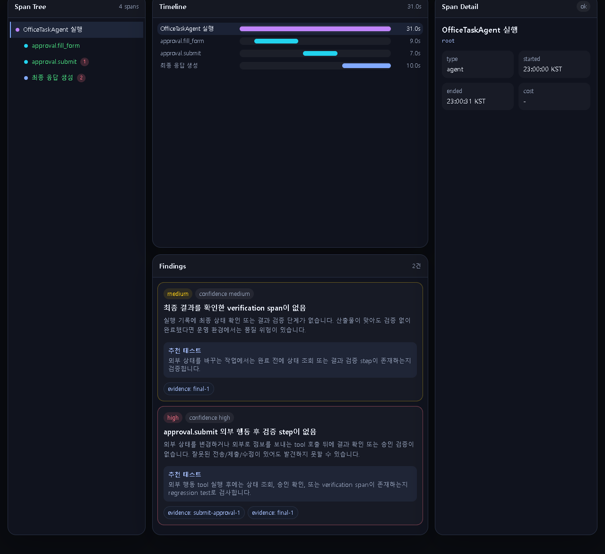

# AgentMRI

AI 에이전트의 실행 로그와 평가 결과를 입력받아 실패 원인, 채점 오류, 회귀 테스트 후보를 evidence 기반으로 도출하는 메타-평가 도구다.

AgentMRI는 Langfuse 같은 observability 플랫폼을 대체하지 않는다. 그 위에서 **이 실행을 믿어도 되는지, 원래 PASS/FAIL 판정이 맞는지**를 감사하는 상위 계층을 목표로 한다.

## 화면

### Verdict Audit — 원래 평가가 맞는지 재감사

원래 PASS 판정이어도 trace evidence가 실패 위험을 가리키면 `evaluator_false_positive_suspected`로 재분류한다.


### Trace Compare — 성공/실패 실행의 first divergence 탐지

두 실행을 step 단위로 정렬해 처음 갈라지는 지점과 downstream 전파를 비교한다.


### Trace Explorer — span tree, timeline, findings

실행 구조를 span tree와 timeline으로 탐색하고, detector finding이 인용하는 evidence span을 확인한다.




## 현재 상태

현재 구현된 첫 scaffold:

- canonical trace TypeScript schema
- trace validation
- 샘플 trace 8종
  - 정상 실행
  - 잘못된 회의 시간 paired failure
  - 반복 도구 호출 루프
  - evaluator false negative 의심 사례
  - 비용 급증
  - 검증 없는 외부 행동
  - 근거 없는 사실 주장
  - 도구 오류 무시
- 규칙 기반 detector 6종
  - D01 반복 도구 호출 루프
  - D03 도구 오류 무시
  - D04 최종 검증 누락
  - D05 검증 없는 외부 행동
  - D06 비용 급증
  - D09 근거 없는 사실 주장
- evidence span과 연결된 finding UI
- 규칙 기반 verdict audit v0
  - true pass/fail 판정
  - evaluator false positive/negative 의심 분류
  - 원래 verdict 신뢰도와 audit confidence 표시
- evidence reference validator
- Trace Compare v0
  - baseline/candidate step alignment
  - first divergence 후보 탐지
  - duration, cost, tool call, error count delta 비교
- span tree, timeline, span detail 화면
- FastAPI validation 및 repeated-loop detection endpoint
- Vitest와 pytest 기본 테스트

아직 구현하지 않은 것:

- LLM audit agent
- regression test export
- Langfuse/OpenTelemetry adapter
- 실제 mock office browser benchmark

## 실행

### 프론트엔드

```bash
npm install
npm run dev
```

브라우저에서 `http://localhost:3000`을 연다.

### 프론트엔드 테스트와 빌드

```bash
npm test
npm run typecheck
npm run build
```

### 백엔드

```bash
pip install -r api/requirements.txt
uvicorn api.app.main:app --reload
```

API 확인:

```bash
curl http://localhost:8000/health
```

### 백엔드 테스트

```bash
pytest api/tests
```

## Canonical Trace 개념

AgentMRI는 서로 다른 에이전트 실행 형식을 하나의 canonical trace로 정규화한다.

핵심 필드:

- `trace_id`: 실행 식별자
- `task`: 목표, 성공 조건, 금지 조건, 환경 정보
- `spans`: agent, llm, tool, retrieval, verification 등 실행 단계
- `evaluation`: 원래 PASS/FAIL 판정과 evaluator 코멘트

각 span은 다음을 포함할 수 있다.

- `span_id`, `parent_span_id`
- `type`, `name`, `started_at`, `ended_at`
- `input`, `output`, `status`, `error`
- `usage.input_tokens`, `usage.output_tokens`, `usage.cost_usd`

## Detector 원칙

모든 finding은 다음을 포함해야 한다.

- failure category
- severity
- confidence
- evidence span id
- recommended regression test

LLM이 나중에 추가되어도 evidence 없는 결론은 허용하지 않는다. structured output validator가 존재하지 않는 span 인용을 거부하는 방향으로 구현한다.

## 프로젝트 구조

```text
agentmri/
  app/                  Next.js app router 화면
  components/           Trace Explorer UI
  fixtures/             샘플 canonical trace
  lib/                  schema, validation, detector, audit
  tests/                Vitest 테스트
  api/
    app/                FastAPI 앱
    tests/              pytest 테스트
```

## 첫 데모 시나리오

1. `반복 루프 실패` 샘플을 연다.
2. D01 detector가 같은 `spreadsheet.get_range` 호출 5회를 evidence로 묶는다.
3. D04 detector가 최종 verification이 없음을 지적한다.
4. 사용자가 evidence 버튼을 눌러 관련 span으로 이동한다.
5. `채점 오류 의심` 샘플을 열면 실행은 성공인데 evaluator가 FAIL인 불일치를 보여준다.
6. Verdict Audit 패널이 이 사례를 `evaluator_false_negative_suspected`로 재분류하고 evidence span을 제시한다.
7. `외부 행동 미검증`과 `근거 없는 주장` 샘플은 PASS 판정이지만 `evaluator_false_positive_suspected`로 재분류된다.
8. Trace Compare에서 `성공 실행`과 `잘못된 회의 시간`을 비교하면 `회의 시간 추출` step을 first divergence 후보로 보여준다.
9. `candidate step 열기`를 누르면 실패 trace의 해당 span detail로 바로 이동한다.

## 설계 방향

AgentMRI의 핵심은 점수 하나를 더 예쁘게 보여주는 것이 아니다.

> 왜 실패했는지, FAIL이 진짜인지, 다음에 같은 실패를 어떻게 잡을지 evidence와 함께 설명한다.

이 방향은 측정 지표를 의심하고 검증하는 접근이다. 따라서 LLM judge 단독 점수보다 deterministic detector, schema validation, hand-labeled fixture, evidence coverage를 우선한다.
